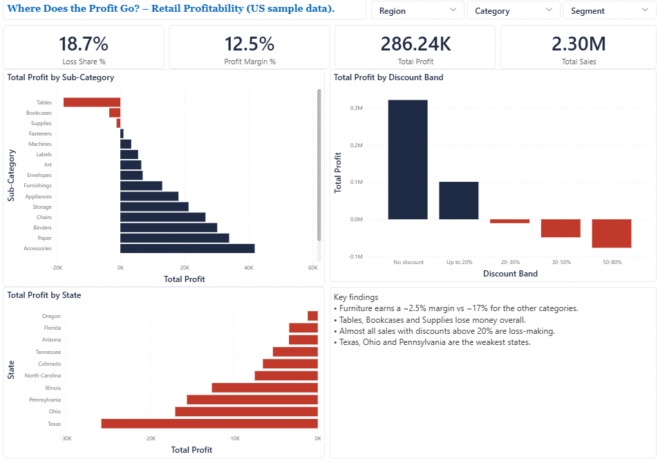

# Retail Profitability Analysis (Superstore)

Where does a retail business lose its profit? An analysis of 9,977 order lines using **SQL and Power BI**.

> **Data note:** This uses the *Sample Superstore* dataset, a publicly distributed **US retail sample dataset**
> (source: Kaggle, Sample Superstore dataset, file SampleSuperstore.csv). It is not Saudi or real company data. I used it to practice an end-to-end analysis workflow.

## Business questions
1. Which categories and sub-categories make or lose money?
2. Which regions and states perform worst?
3. How does discounting affect profit?

## Data and cleaning
- Original file: 9,994 rows, 13 columns.
- Restored the leading zero in 449 postal codes (New England states and New Jersey).
- Removed 17 fully identical rows. The file has no order ID, so these could be legitimate repeat purchases; I treated them as duplicates (under 0.2% of rows), which is an assumption.
- Added `Discount Band` and `Is Loss` columns.
- Final file: 9,977 rows (`superstore_clean.csv`).
- The dataset has no date column, so there is no time-trend analysis.

## Key findings
- Total sales **$2.30M**, total profit **$286K**, overall margin **12.5%**.
- **Furniture** earns almost the same sales as Technology but only a **2.5%** margin (Technology 17.4%, Office Supplies 17.0%).
- Three sub-categories lose money: **Tables (-$17.7K)**, **Bookcases (-$3.5K)** and **Supplies (-$1.2K)**.
- **Discounting is strongly associated with losses:** sales with no discount earned $321K profit, while lines discounted above 20% lost about $135K in total. 1,346 of the 1,391 lines (about 97%) with discounts above 20% were loss-making, and every line with a 50-80% discount lost money.
- Weakest states: **Texas (-$25.8K)**, Ohio (-$17.0K), Pennsylvania (-$15.6K), Illinois and North Carolina.
- **Central** is the weakest region (7.9% margin vs 14.9% in the West).

## Recommendations
- Review pricing and discount levels for Tables and Bookcases.
- Introduce a discount cap (for example 20%), or require approval above it.
- Investigate Texas, Ohio and Pennsylvania, and check whether discounting explains their losses.
- Look into why the Central region has a lower margin.

*This analysis is descriptive. It shows association, not proven causation.*

## Tools
- **SQL:** 6 queries in `superstore_queries.sql` (run on a MySQL-compatible database, MariaDB via XAMPP).
- **Power BI:** interactive dashboard with filters by region, category and segment. DAX measures are in `dax_measures.txt`.

## Files
- `superstore_clean.csv` – cleaned data
- `superstore_queries.sql` – SQL queries
- `dax_measures.txt` – Power BI measures
- `superstore_dashboard.pbix` / `dashboard.png` – Power BI file and screenshot
